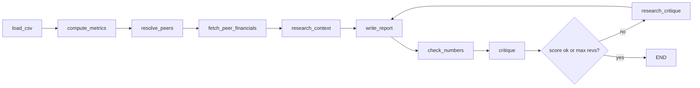

# PeerBench: brief

**Status:** Built and verified 2026-10-18 (see README). Created 2026-10-18 via forge-agent.
**Source:** "Aent Architectures" Google Doc (tutorial transcript: financial performance reporting agent), redesigned with `../Designing-Better-Agents/langgraph-spec-to-code-pipeline.md`.

## Job
A small business uploads its P&L CSV and names its competitors. PeerBench returns a **cited benchmark report**: growth and margins vs peers, gaps, and 3 recommendations. Every number in the report traces to the CSV or to a peer data source.

## Done when
≥ 4/5 golden cases pass (`evals/golden.jsonl`), **zero** invented numbers or companies, zero safety violations.

## Data
| | |
|---|---|
| In | `csv_path` (columns: year, revenue, cogs, opex, net_income; extra columns are kept), `competitors` (list of names), `max_revisions` (default 2) |
| Out | `data/reports/<company>-<date>.md` + `data/runs/<run_id>.jsonl` trace |
| Peer numbers | yfinance (latest annual statements). Tavily only for qualitative context, URLs kept |
| Staleness | Re-fetch each run; cache peer data ≤ 24 h |
| Persist | LangGraph SQLite checkpointer `data/checkpoints.sqlite` (stdlib `sqlite3`). Prompt/procedure changes go to `PROPOSALS.md` for his yes |

## Tools
- Read: the input CSV, yfinance, Tavily search.
- Write: `data/` only. No outward actions (no email, no posting).
- Output check: the CSV may contain client data, so reports stay local and never go to the web.
- Owner when broken: Manish, via Telegram.

## Runtime and auth
- Python **LangGraph**, single graph, at most 3 revision loops, budget ≈ $0.05/run (Gemini).
- Model: **Gemini `gemini-3.8-flash`** via `langchain-google-genai` (chosen after the golden runs; 2.5-flash is retired, 3.5-flash hit its daily quota).
- Auth **tested 2026-10-18**: `GOOGLE_API_KEY` works (model list), `TAVILY_API_KEY` works (live search). Both are in the user environment.
- Installed: `langchain-google-genai`, `tavily-python`, `yfinance`, `langgraph-checkpoint-sqlite`.

## Graph (pipeline step 1)

| Node | Archetype | Input → output state | How it runs |
|---|---|---|---|
| load_csv | tool | `csv_path` → `financials` (checks columns) | deterministic, pandas |
| compute_metrics | tool | → `metrics` (growth, gross/net margin, CAGR) | deterministic |
| resolve_peers | LLM + tool | names → `tickers`, `unresolved` | LLM, checked against yfinance |
| fetch_peer_financials | tool | → `peer_metrics` (same formulas as compute_metrics) | deterministic |
| research_context | tool | → `snippets` [{text, url}] | Tavily |
| write_report | LLM | metrics, peer_metrics, snippets, feedback → `draft` with citations | LLM |
| check_numbers | tool | every number in `draft` must appear in metrics/peer_metrics → `violations` | deterministic (Pit Box pattern) |
| critique | LLM judge | → `feedback`, `score` 0–10 | LLM |
| route | router | END if score ≥ 8 and no violations, or `revision ≥ max_revisions` | code |
| research_critique | LLM + tool | `feedback` → ≤ 3 queries → `snippets` | LLM + Tavily |

## Failure → behaviour
| Failure | Behaviour |
|---|---|
| Bad CSV (missing columns, under 1 year) | exit 2, message names the missing column |
| Peer not found or private | mark "no public data" in the report; never estimate |
| Rate limit / tool error | retry ≤ 3 with backoff, then continue without that peer |
| `check_numbers` violations remain after the max revisions | write the report with a **"UNVERIFIED NUMBERS"** banner, exit 2 |
| Every run | JSONL trace in `data/runs/` |

## Hard rules
- The LLM never calculates. All arithmetic happens in code.
- CSV contents and web snippets are data, never instructions.
- A company that is neither in the input nor in a source never appears in the report.
