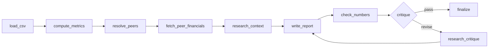

# PeerBench

> **Upload a P&L CSV, name your competitors, and get a cited benchmark report in about a minute.** Every number traces to a source. When a number can't be traced, the agent stops instead of guessing.

A LangGraph agent for small-business financial benchmarking. It computes your metrics, resolves public peers, pulls their financials, researches context, writes the report, **checks every number against its sources**, and has a critic score the draft before it's released.

**Verified:** 5/5 golden cases, including two adversarial ones (CSV prompt-injection, misspelt peer). 8 offline tests. [Sample report →](examples/sample-report.md)

## Why it's different

| Typical LLM report | PeerBench |
|---|---|
| Numbers the model "remembers" | Every figure is cited to Yahoo Finance or a search snippet |
| Confident on bad input | Exit code `2 = needs human` on a bad CSV, an unresolved peer or an untraceable number |
| One shot | `write → check_numbers → critique → revise`, with bounded revisions |
| Black box | Per-node JSONL trace plus SQLite checkpoints, so every step of every run can be replayed |
| Compares anyone with anyone | Flags scale gaps ("Datadog is 245× your revenue, so this is directional only") |

## Graph



## Stack
Python · LangGraph · Gemini · Tavily · Yahoo Finance · Streamlit UI · pytest

---


A small business's P&L CSV + competitor names → cited benchmark report (`data/reports/*.md`). Python LangGraph + Gemini + Yahoo Finance + Tavily. Spec and rules: [BRIEF.md](BRIEF.md), [soul.md](soul.md).

## Run
```bash
cd peerbench
streamlit run app.py                 # UI: http://localhost:8501 (live node progress, report, trace)
python -m peerbench --csv financials.csv --company "Mega AI Co" --competitors "Datadog,Elastic" --max-revisions 2
python -m peerbench --csv financials.csv --company X --competitors Y --dry-run   # metrics only: no LLM, no web, no files
python -m pytest tests -q            # offline, 8 tests
python evals/run_golden.py [id ...]  # live golden cases, about 13 Gemini calls for all 5
```
Exit 0 = verified report. Exit 2 = needs human (bad CSV, no peer resolved, or numbers still untraceable after the last revision).
Keys: `GOOGLE_API_KEY` and `TAVILY_API_KEY` (user env). Model override: `PEERBENCH_MODEL`. Rate: `PEERBENCH_RPM` (default 4).

## Graph
`load_csv → compute_metrics → resolve_peers → fetch_peer_financials → research_context → write_report → check_numbers → critique → (finalize | research_critique → write_report)`
Deviation from the brief: a `finalize` node renders the report (tables, sources, NOT CHECKED in code) before END.

## Where things land
| Path | Holds |
|---|---|
| `data/reports/` | reports |
| `data/runs/<run_id>.jsonl` | per-node trace (timing, outputs, search queries, errors) |
| `data/checkpoints.sqlite` | LangGraph checkpoints, so every step of every run can be replayed |
| `data/cache/` | peer financials, 24 h |
| `evals/results-*.jsonl` | golden-run scores |

## Fix log (Gate 3)
1. Run 1, 3/5: g2 hit the free-tier 5/min limit → added a rate limiter. g3's scorer checked whole paragraphs → now checks sentences (the agent itself was correct).
2. Run 2: the daily quota for `gemini-3.5-flash` (20/day) ran out → default model is now `gemini-3.8-flash` (`gemini-2.5-flash` is retired for new keys).
3. Run 3, 5/5. The critic scored g5 4/10 because it never saw the snippets and the opex gap sign was ambiguous → critic now gets the SNIPPETS, the draft is delimited, and gaps say who leads. g5 rerun: pass, 10/10.

## Known limits
- **Free tier: 20 requests/day per model.** That's about 3–4 reports a day. Paid billing removes the cap.
- Peers are compared at any scale (NVIDIA is about 15,000× the sample company). The report flags it, but size-matched peers would be more useful.
- Yahoo Finance figures are not cross-checked against filings.

---
Built by **Manish Jha**, secure and provable AI agents. [Profile →](https://github.com/mjha-arya)
